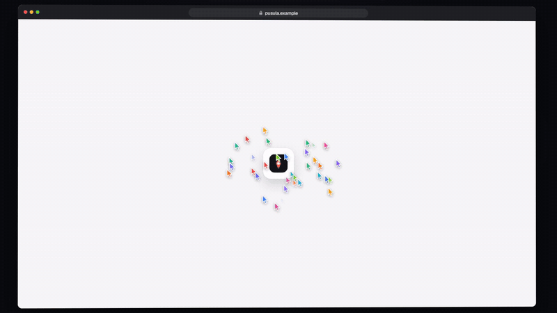
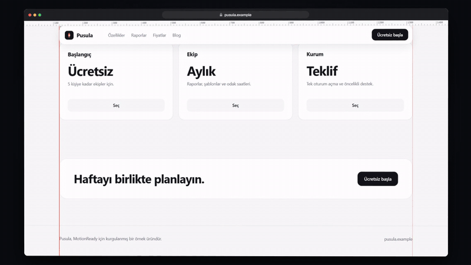
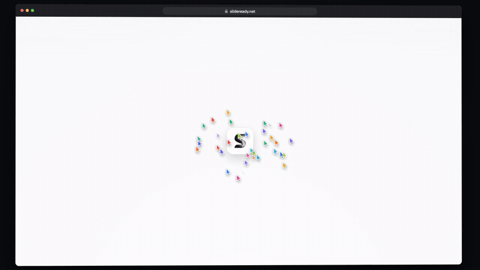

<div align="center">

# MotionReady

**Give it a web page, get a launch film of that page being built on screen.**

The page is captured, wiped and rebuilt piece by piece by dozens of tool-tagged cursors. All of it is code, frame by frame, and every render gives the same result.

[Quick start](#quick-start) · [Project settings](docs/project-settings.md) · [How it works](docs/architecture.md) · [Quality check](docs/quality-check.md) · [Agent guide](AGENTS.md) · [Türkçe](README.tr.md)



</div>

*The GIF above is taken from a real render of the repo's fictional demo page (`projects/demo`). The full film is 1920 × 1080, 60 fps, with sound and 25 seconds long; the GIF is silent.*

## What it does

| Step | What happens |
|---|---|
| **Capture** | The page opens in headless Chrome. Scroll-triggered animations are finished. Three full-page shots of the same layout are taken (the finished page, empty surfaces, section backgrounds only), plus the box of every element. The logo is captured sharp on its own. |
| **Plan** | Sections become scenes and elements become cursor tasks. In each section the camera stops where the headline stays clear of the nav, and whips quickly in between. Cuts land on the music's tempo. |
| **Build** | Each card is drawn with a crosshair and opens with a `W × H` badge. Text is typed with a caret; a headline is typed small and then stepped up from its corner handle. Pictures flow in from top to bottom out of a placeholder. Repeated cards are ⌥-dragged copies of the first, with a red spacing measurement. A cursor with no work does not wait in the window: it leaves by the edge and comes back when it has a task. |
| **Finish** | The swarm gathers on the CTA button and presses it. Then it spins up like a tornado in the middle and draws the product's logo; the sharp logo lands in its place. |
| **Sound** | UI effects are synthesized from the build's own moments. You can add your own music (its drop lands on the film's drop). The mix is set to -14 LUFS with a -1.5 dBTP peak. |



An example with a real product page (`projects/slideready`, live [slideready.net](https://slideready.net)):



## Quick start

You need **Node.js 22+**, **ffmpeg** (on the PATH) and **Chrome, Edge or Chromium**. If the browser is somewhere unusual, point to it with `CHROME_PATH`.

```bash
git clone https://github.com/berkanarin/MotionReady.git
cd MotionReady
npm install
node scripts/check.mjs
```

Produce the sample demo end to end (capture → plan → sound → film → GIF):

```bash
node mr.mjs all demo
```

Outputs go to `projects/demo/out/`: `demo.mp4` (full quality), `demo-share.mp4` (small copy for sharing), `demo.gif`, `soundtrack.wav`, `cues.json`.

## With Claude Code (or another coding agent)

The easiest way: open the repo in Claude Code and ask for a video of your site. [`AGENTS.md`](AGENTS.md) tells the agent the whole flow: capture the page, show you the plan and a scene table for approval, render, check the frames and deliver. Ready-made prompts are in [`prompts/`](prompts/README.md).

```text
Read AGENTS.md. Make a 15-second landscape film of https://my-product.com.
```

## For your own page

```bash
node mr.mjs new myproduct https://myproduct.com
node mr.mjs capture myproduct
```

`capture` also prints the plan: which section becomes which scene, where the camera stops, when each scene ends and whether any block is late. Then fine-tune `projects/myproduct/project.json`:

```json
{
  "name": "myproduct",
  "url": "https://myproduct.com",
  "format": "landscape",
  "bpm": 120,
  "scenes": [
    { "section": "hero", "bars": 2 },
    { "section": "features", "bars": 1.5 },
    { "section": "pricing", "bars": 1.5 }
  ],
  "tags": ["Board", "Report", "Calendar"],
  "cta": "Start free",
  "end": { "title": "MyProduct", "subtitle": "A short promise.", "button": "Get started", "url": "myproduct.com" },
  "capture": { "hide": [".cookie-banner"] },
  "audio": { "music": "mytrack.mp3", "musicDrop": 12.4 }
}
```

All fields and their defaults: [project settings](docs/project-settings.md).

```bash
node mr.mjs plan myproduct              # plan report
node mr.mjs stills myproduct 2s,6.5s    # single frames
node mr.mjs sheet myproduct 20          # 20-frame contact sheet
node mr.mjs audio myproduct             # sound
node mr.mjs render myproduct            # film
node mr.mjs gif myproduct 0 8 800 12    # GIF of 0–8 s, 800 px wide, 12 fps
node mr.mjs studio                      # Remotion Studio (props: {"project":"myproduct"})
```

Short films (10 s and under) work too: lower `hook`, raise `bpm` and shorten the end card with `end.duration`.

If a site blocks headless browsers, open it in your own browser, save it with **Ctrl+S → "Web page, complete"** into `projects/<name>/site/` and set `"url": "site/index.html"`.

## Repo layout

| Path | Contents |
|---|---|
| [`mr.mjs`](mr.mjs) | The single entry point (CLI) |
| [`scripts/`](scripts) | Capture (`capture.mjs`), render and GIF (`render.mjs`), sound (`audio.ts`), plan report (`report.ts`), repo check (`check.mjs`) |
| [`src/engine/`](src/engine) | Pure functions: timing and camera (`timing.ts`), task plan and cursor motion (`plan.ts`), end-card beats (`endTiming.ts`) |
| [`src/film/`](src/film) | Remotion components: browser window and design layer, page blocks, swarm, hook, end card |
| [`projects/`](projects) | One folder per project: `project.json` (+ `capture/`, `audio/`, `out/`, which stay out of git) |
| [`docs/`](docs/README.md) | Setup, settings, architecture, quality check, sound, troubleshooting |
| [`prompts/`](prompts/README.md) | Ready-made prompts for a coding agent |
| [`media/`](media) | README GIFs and contact sheet (real renders) |

## License

MotionReady is released under the [MIT license](LICENSE): you may use, change and distribute it, commercial work included. The only condition is that the copyright and license notice stays in copies.

**Remotion is licensed separately.** MotionReady renders with [Remotion](https://www.remotion.dev). Remotion is free for individuals and small teams; if you use it on behalf of a larger company, you need a [Remotion company license](https://www.remotion.dev/license). MotionReady's MIT license does not cover it.

## Thanks

- The idea of a swarm building the page is inspired by Joel Califa's [Swarm](https://califa.github.io/swarm-site/) site and the [swarm-cursors](https://github.com/DhvanilPatel/swarm-cursors) extension that followed it. This repo contains **none** of their code: both were published without a license, and the extension's author asks that the code not be reused without consulting Joel Califa. The engine was written from scratch.
- The product, names and texts on the `projects/demo` page are fictional (and in Turkish, like the `slideready` example).
- Your own music and sound files stay under `projects/<name>/audio/` and out of git; each file keeps its own license.
